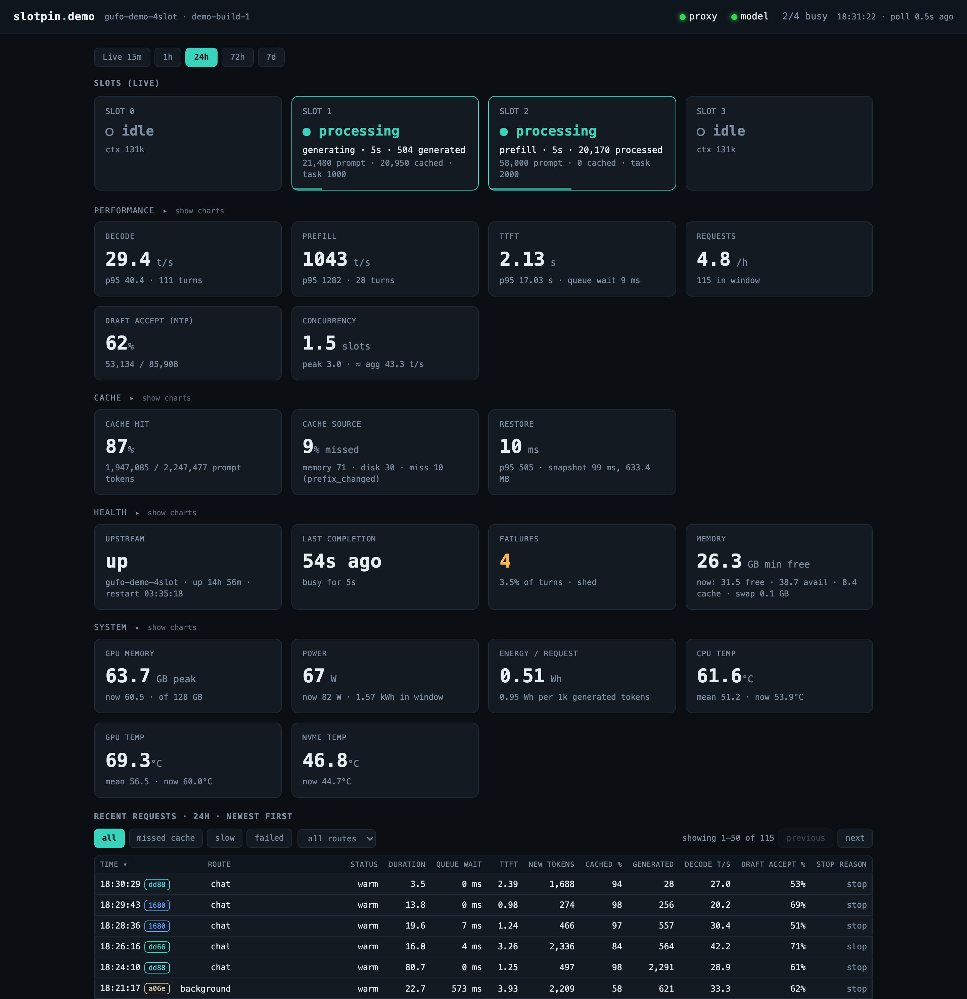

# slotpin

`slotpin` is a slot-pinning, cache-aware reverse proxy for a local LLM inference server (llama.cpp's `llama-server`, or the Gufo engine), plus a read-only dashboard. It keeps interactive conversations warm so a returning user is not hit with a long cold prefill, and it records a per-turn metric stream (speed, latency, cache behaviour, memory, optionally energy).



*The dashboard on synthetic demo data from `tools/demo_dashboard.py`. Charts and the phone layout are in [docs/dashboard.md](docs/dashboard.md).*

## What it does

- **Slot pinning.** Sets `id_slot` on each request so a conversation lands in the KV slot that already holds it.
- **Warm and cold lanes.** Classifies requests by regex into lanes and tiers; one lane is the interactive one that gets protected.
- **KV save/restore and prefix restore.** Saves the interactive slot to disk and restores it when something else evicted it. Optionally restores the snapshot that shares the longest prefix with a new prompt.
- **Priority scheduler.** Tiered admission with aging (so background work is delayed, never starved), a queue limit and optional load shedding, for one or many slots.
- **Fail-fast on a silent upstream.** Aborts a stalled stream, and can turn a stall before the first token into a clean `504` the client can fall back from.
- **Per-turn metrics.** One JSON line per turn: time to first token, decode and prefill speed, warm or cold, queue wait, memory, speculative-decoding acceptance and, with a smart plug, energy per turn. No prompt or reply text is recorded.
- **Read-only dashboard.** A separate process that shows live state and 1 hour to 7 day history from the metric stream.
- **Gufo mode.** With `upstream_kind = "gufo"` it keeps classification, scheduling, fail-fast and metrics, and leaves caching to Gufo.

## Requirements

- Python 3.11 or newer. The runtime uses only the standard library.
- Linux for the full stack (systemd units, `/proc/meminfo`, hwmon temperatures, sysfs GPU memory). The proxy itself runs wherever Python runs; on other systems the memory and temperature fields are simply empty.
- An inference server: `llama-server` started with `--slot-save-path` (for KV save/restore), `-np N` equal to `slots`, and `--cache-ram` equal to `cache_ram_mb`; or Gufo with `--sessions` at least `slots`.
- Optional: an ESPHome smart plug for energy ([docs/energy.md](docs/energy.md)), `llama-swap` in front of `llama-server`, and Node.js (any recent LTS) to run the dashboard page-script tests (they skip without it).

## Quick start: llama-server

1. Start `llama-server` with the flags that matter. Example for one slot:

   ```
   llama-server -m model.gguf --host 127.0.0.1 --port 8080 -np 1 \
     --slot-save-path /var/lib/slotpin/kv-cache --cache-ram 2048
   ```

2. Install slotpin: `pip install .` (or `pip install -e .[dev]` to work on it). This provides `slotpin-proxy` (also `slotpin`) and `slotpin-dash`.
3. Copy the example config and edit it: `cp config.example.toml config.toml`.
4. Change the few keys that depend on your setup: `upstream_port` and `admin_port` (both the port `llama-server` listens on; they differ only when `llama-swap` sits in front, in which case `admin_port` is the `llama-server` behind it), `slot_save_path` (the directory you gave `--slot-save-path`), `cache_ram_mb` (the number you gave `--cache-ram`), `slots` (the `-np` value), and the `match` pattern of the `chat` lane so it recognises your interactive client's requests.
5. Check it: `slotpin-proxy --config config.toml --check`. It prints `slotpin: config OK` on stdout, a summary and any warnings on stderr, and exits non-zero on an error.
6. Run it: `slotpin-proxy --config config.toml`.
7. Point your client at `http://127.0.0.1:8090/v1/...` instead of the server:

   ```
   curl http://127.0.0.1:8090/v1/chat/completions \
     -H 'Content-Type: application/json' \
     -d '{"model":"any","messages":[{"role":"user","content":"Say hello."}],"stream":false}'
   ```

Metrics are appended to `/var/lib/slotpin/metrics.jsonl` (the `metrics_file` key; the directory must exist and be writable by the user running the proxy). `GET /_stats` returns live counters, `GET /health` reports whether the upstream is reachable, and `GET /ready` whether the proxy is up. Every other request is passed through to the upstream unchanged.

## Quick start: Gufo

Same steps, using the Gufo example: `cp config.example.gufo.toml config.toml`. Start Gufo with `--sessions` at least as large as `slots`, and set `upstream_port` and `admin_port` to Gufo's port (the example uses `8080` for both). Gufo owns prompt caching, so `kv_persist`, `kv_adaptive` and `prefix_restore` must stay `false`; `--check` rejects them otherwise. See "Running in front of Gufo" in [docs/operations.md](docs/operations.md).

## Dashboard

The dashboard is a separate process configured only by `DASH_*` environment variables, all with defaults. Point it at the same metrics file and server as the proxy:

```
DASH_METRICS=/var/lib/slotpin/metrics.jsonl \
DASH_UPSTREAM=http://127.0.0.1:8080 \
DASH_DB=$HOME/slotpin-rollup.db \
slotpin-dash
```

Open `http://127.0.0.1:8091`. It shows whether the proxy and upstream are up, slot occupancy, throughput and time to first token, how decode and prefill speed fall with context depth, warm and cold rates, queue waits, GPU and host memory, temperatures, and optionally power and energy, live and over 1 hour, 24 hours, 72 hours and 7 days, with a request list. It never writes to the proxy's data and never serves prompt text. The variable list is in [docs/configuration.md](docs/configuration.md#dashboard-environment-variables); details are in [docs/dashboard.md](docs/dashboard.md).

## Try the dashboard with demo data

To see the dashboard without a server or a proxy, run the demo tool from a checkout:

```
python tools/demo_dashboard.py
```

It prints a URL (`http://127.0.0.1:8099/` by default). Everything runs on loopback: a fake upstream with four slots, a fake energy feed, seven days of invented `metrics.jsonl` and history (including one restart and one stall), and the real dashboard reading them. Nothing is read from your machine, so it looks the same on macOS and Linux. Stop it with Ctrl-C; `--seed`, `--port` and `--once-seconds N` are the useful flags. `tools/capture_screenshots.py` regenerates the images in `docs/img` from it with headless Chrome.

## Durable install (systemd)

```
sudo ./deploy/install.sh --config config.example.toml --user <service-user> --enable [--dash]
```

This creates a virtualenv at `/opt/slotpin/venv`, installs `/etc/slotpin/config.toml`, the unit `slotpin-proxy.service` (and `slotpin-dash.service` with `--dash`), `/var/lib/slotpin` for snapshots and metrics, `/var/lib/slotpin-dash` for the dashboard database, the optional environment files `/etc/slotpin/slotpin.env` and `/etc/slotpin/slotpin-dash.env`, and a logrotate rule for the metrics file. The proxy unit runs `--check` before every start. The script is safe to re-run and keeps an existing config unless `--force-config` is given.

Edit the installed config for your setup, then `systemctl restart slotpin-proxy`. If you use `llama-swap`, install `deploy/systemd/llama-swap-pair-slotpin.conf` as a drop-in for the `llama-swap` unit so the proxy restarts whenever `llama-swap` does. Unit files are in `deploy/systemd/`; the logrotate rule is `deploy/logrotate/slotpin-metrics`.

## Security

**Neither the proxy nor the dashboard has authentication.** Both listen on loopback by default. Do not bind them to a network you do not control. To reach them remotely, use a VPN or a reverse proxy that authenticates. The metrics contain no prompt or reply text, and the dashboard does not serve the upstream's `/slots` prompt text, but KV snapshots on disk are derived from conversations, so protect `slot_save_path`. See [SECURITY.md](SECURITY.md).

## Configuration

Settings come from a TOML file (`--config`), and every scalar key can be overridden by a `SLOTPIN_<KEY>` environment variable. Precedence: built-in defaults, then the file, then the environment. The classification rules (`[[classify.lanes]]`, `[[classify.demote]]`, `[[classify.labels]]`) are TOML only. The dashboard reads `DASH_*` environment variables only. The full reference, the validation rules and the warnings `--check` can print are in [docs/configuration.md](docs/configuration.md).

## How it works

[docs/how-it-works.md](docs/how-it-works.md) explains the mechanisms and the reasoning: why single-slot setups go cold, slot pinning, lanes, the inferred cache-ram pool, disk save/restore, prefix restore, the scheduler, reload handling, Gufo mode, fail-fast and the failure record. [docs/architecture.md](docs/architecture.md) covers the request lifecycle and known limits.

## Documentation

- [docs/how-it-works.md](docs/how-it-works.md): mechanisms and why.
- [docs/architecture.md](docs/architecture.md): topology, request lifecycle, design rationale, known limitations.
- [docs/configuration.md](docs/configuration.md): every config key, every `DASH_*` variable, validation rules.
- [docs/dashboard.md](docs/dashboard.md): dashboard endpoints, health and stall detection, history tables.
- [docs/metrics.md](docs/metrics.md): the metric record schemas and `/_stats`.
- [docs/energy.md](docs/energy.md): whole-box energy capture with an ESPHome plug.
- [docs/operations.md](docs/operations.md): operating rules, running in front of Gufo, restart matrix.
- [docs/troubleshooting.md](docs/troubleshooting.md): symptom, cause and fix for the common failures.
- [docs/concurrency-design.md](docs/concurrency-design.md): design of record for multi-slot and multi-model concurrency.
- [SECURITY.md](SECURITY.md), [CONTRIBUTING.md](CONTRIBUTING.md), [CHANGELOG.md](CHANGELOG.md).

## Status

Alpha (`1.0.0a`). Configuration keys and the metrics format may still change between releases. Built and tested: slot pinning and pooled multi-slot scheduling, lanes and tiers, KV save/restore, prefix restore, reload detection, fail-fast, per-turn metrics with energy, the dashboard, and Gufo mode. Designed but not built: routing between multiple models (see [docs/concurrency-design.md](docs/concurrency-design.md)).

To develop: `uv sync --extra dev && uv run --extra dev pytest -q`, or `pip install -e .[dev] && pytest -q`. See [CONTRIBUTING.md](CONTRIBUTING.md).

## Licence

MIT. See [LICENSE](LICENSE).
