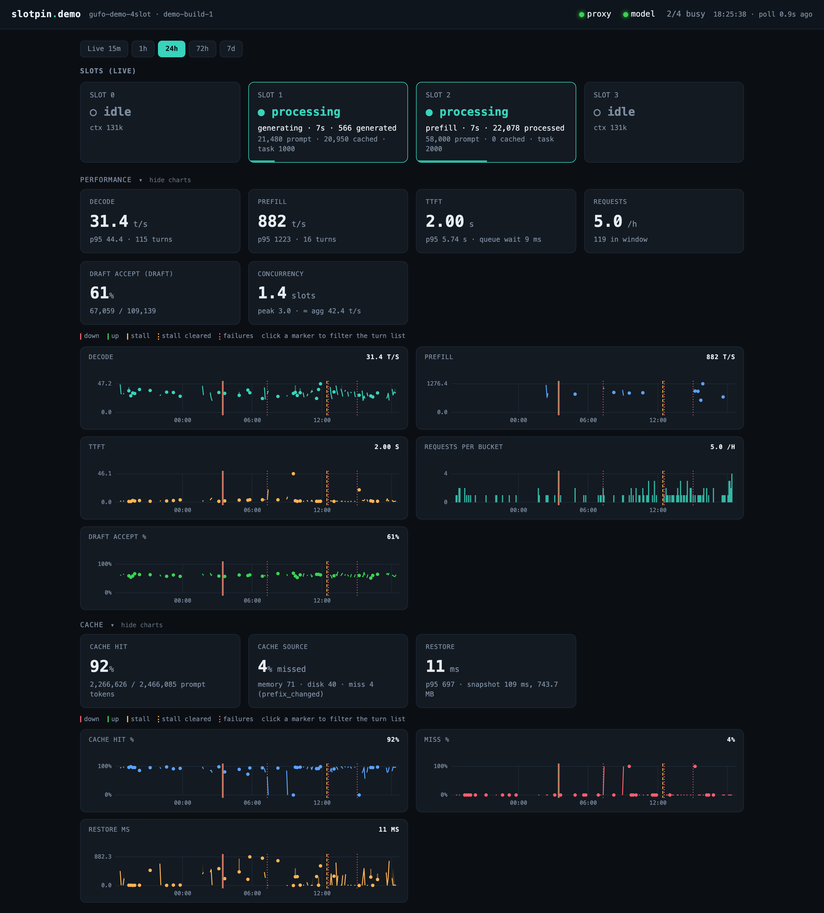
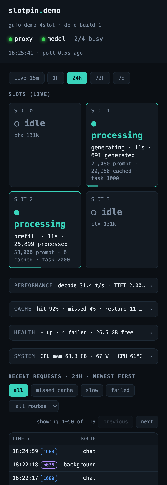

# Dashboard (`slotpin-dash`)

A read-only web dashboard for a running `slotpin-proxy`. It is a **separate
process** from the proxy and never writes to the proxy's data — it observes
`metrics.jsonl`, the `llama-server` `/slots` admin endpoint, the whole-box
energy feed, `/proc/meminfo`, and hwmon temperature sensors, and serves a live
view plus a bucketed historical view over `1h / 24h / 72h / 7d`. Like the
proxy, it is **stdlib-only** (`http.server`, `urllib`, `sqlite3`) — no runtime
dependencies.

Each dashboard instance watches one box; an optional header nav (`DASH_BOXES`)
cross-links the dashboards of other boxes so you can click between them. With
`DASH_BOXES` empty (the default) there is no box switcher.



*Performance and Cache groups expanded on the 24 h window, with restart and stall markers. Demo data from `tools/demo_dashboard.py`.*

On a phone the groups collapse to one-line summaries and the slot tiles sit two per row:



## Running it

Install with `sudo ./deploy/install.sh --config config.example.toml --user <service-user> --enable --dash`
(see `docs/operations.md`), or run the console entry point installed with the
package:

```
slotpin-dash            # binds 127.0.0.1:8091 by default
```

or as a systemd service by hand (see `deploy/systemd/slotpin-dash.service`):

```
sudo cp deploy/systemd/slotpin-dash.service /etc/systemd/system/
sudo systemctl daemon-reload
sudo systemctl enable --now slotpin-dash
```

All settings have built-in defaults; override any via
`/etc/slotpin/slotpin-dash.env` (see `deploy/systemd/slotpin-dash.env.example`).
The environment variables, read once at start-up:

| Variable | Default | Meaning |
|---|---|---|
| `DASH_HOST` / `DASH_PORT` | `127.0.0.1` / `8091` | Bind address. |
| `DASH_METRICS` | `/var/lib/slotpin/metrics.jsonl` | The proxy's `metrics_file`. |
| `DASH_UPSTREAM` | `http://127.0.0.1:5802` | Base URL of the llama-server (or Gufo) whose `/slots` and `/metrics` are read. |
| `DASH_PROXY` | `127.0.0.1:8090` | The proxy's `host:port` (a TCP liveness check). |
| `DASH_ENERGY` | unset | Energy feed URL. **Unset or empty = the energy feed is off** (no request is made and the power/energy cards show no data). Must be an ESPHome Prometheus `/metrics` page; see `docs/energy.md`. |
| `DASH_SLOTPIN_CFG` | `/etc/slotpin/config.toml` | The proxy's config file, read for `upstream_config_id` and `slots`. |
| `DASH_CFG` | empty | Fallback config id label when the config file has no `upstream_config_id`. |
| `DASH_DB` | `/var/lib/slotpin-dash/rollup.db` | SQLite rollup database (the systemd unit provides the directory via `StateDirectory`). |
| `DASH_WINDOW_MIN` | `15` | The live window, minutes. |
| `DASH_POLL_SEC` | `3` | Poll and rollup cadence, seconds. |
| `DASH_STALL_S` | `300` | Stall threshold, seconds (see below). |
| `DASH_DRAFTER` | unset | Name in the "Draft accept" card label (see below). |
| `DASH_HWMON` | `/sys/class/hwmon` | hwmon root for temperatures. |
| `DASH_TEMP_WARN_C` / `DASH_TEMP_CRIT_C` | `85` / `95` | Temperature card amber / red thresholds. |
| `DASH_LABEL` | the hostname | This box's name, shown in the header and matched against `DASH_BOXES` to highlight the active tab. |
| `DASH_BOXES` | empty | `name=url,name=url,...` for the header's box switcher; empty = no switcher. |

The data-source variables (`DASH_METRICS`, `DASH_UPSTREAM`, `DASH_PROXY`,
`DASH_SLOTPIN_CFG`) must point at the same deployment the proxy uses.

**There is no authentication.** The dashboard exposes aggregate operational
metrics (no prompt content; `metrics.jsonl` never contains request text), but it
is still information about your deployment. It binds loopback by default; only
bind a LAN or VPN address behind a firewall or an authenticating reverse proxy,
and do not expose it to untrusted networks (see `SECURITY.md`).

## Endpoints

The handler serves exactly these `GET` routes; any other path returns 404 and
there are no non-`GET` routes.

- `GET /` — the HTML dashboard (auto-refreshes every 3s).
- `GET /api/state` — live JSON: health, current slots, current power/free-RAM,
  the last-15-min window, and the recent-request stream.
- `GET /api/history?window=<seconds>` — a window summary, the chart series
  (`samples`, `request_series`, `depth`) and event markers, plus the legacy downsampled
  `series` (the page no longer uses it). `window` (seconds, default 3600) is
  clamped to `[300, 8d]`.
- `GET /api/depth?window=<seconds>` — only the `depth` object of `/api/history`
  (decode and prefill speed per context-depth bin, see `depth_series` below),
  same `window` handling, for scripts and curl. The page itself reads it from
  `/api/history`.
- `GET /api/requests?window=<sec>&from=&to=&offset=&limit=&filter=&route=` — the
  paged request list from the `requests` table (below), newest first. `window`
  clamped to `[300, 8d]` (default 3600); optional `from` / `to` (epoch seconds,
  either or both, inclusive) select an explicit time range instead of the
  window, clamped to `[now - 8 d, now]`; a non-numeric or non-finite value, or
  `from` after `to`, returns 400. A missing `to` is now, a missing `from` is the
  window start. The `slow` threshold is still the p95 of the window. With a
  range the response also carries `from` and `to` (as clamped); `limit` default 50, clamped to
  `[1, 200]`; `offset` clamped to >= 0; `filter` is `all` (default), `miss`
  (`served != warm`), `slow` (`ttft_s` above the window's p95 of `ttft_s`,
  nearest-rank over ok rows in the same window and all routes) or `failed`;
  `route` is an optional exact match. Returns `{"total", "window_sec",
  "slow_ttft_s", "rows"}` (`slow_ttft_s` is the window's p95 TTFT used by the `slow` filter, null when no data); `total` is the count matching the filters (ignoring paging). Each
  row carries the table columns plus derived `new_tokens` (`prompt_n -
  cache_n`) and `cached_pct`; fields a record lacked are `null`. A
  non-numeric `window`/`offset`/`limit`, an unknown `filter` or an over-long
  `route` returns HTTP 400 with `{"error": ...}`.

## Health, stall detection and events

The upstream state is derived only from `/slots` (never the upstream's
`/health`, which kept answering during a real stall):

- `down` — `/slots` is unreachable. Never reported as `stalled`.
- `stalled` — some slot is busy (`is_processing`), its tuple
  (`n_prompt_tokens_processed`, `next_token[0].n_decoded`; either may be
  absent) has not changed for `DASH_STALL_S`, **and** no turn completed (no new
  `ok` record ingested from `metrics.jsonl`) within `DASH_STALL_S`.
- `up` — otherwise.

A stall clears when the tuple changes, a turn completes, or the slot goes idle;
if `/slots` becomes unreachable mid-stall the stall is closed (state `down`).
The state machine is `slotpin.dash.StallTracker`; its clock restarts when the
dashboard restarts or `/slots` was unreachable.

Setting: `DASH_STALL_S` (float seconds, default `300`).

`/slots` objects contain the prompt text. The collector passes every object
through `slotpin.dash._slot_fields`, which copies only a fixed set of
numeric/boolean fields (`id`, `is_processing`, `id_task`, `n_prompt_tokens`,
`n_prompt_tokens_cache`, `n_ctx`, `n_prompt_tokens_processed`, `n_decoded`);
the prompt (and reply) text is never kept, logged, stored or returned by any
endpoint. Tests in `tests/test_dash_health.py`:
`test_slot_fields_drop_prompt_text` (the filter) and
`test_collector_path_never_stores_or_serves_prompt` (the collector's state,
`build_state`, `build_history`, the database file and stdout/stderr never contain
a planted secret).

**Restart detection.** `down` and `up` come from `slotpin.dash.RestartDetector`,
fed once per poll. The detector state (last state, config id, upstream build,
the upstream's cumulative token counters) is stored in the `meta` table
(`restart_state`) and the events are written to SQLite as soon as they happen,
so a new dashboard process continues from what the old one last saw. Rules:

- `/slots` reachable to unreachable records `down`; unreachable to reachable
  records `up` (no detail).
- First poll of a new dashboard process, persisted state `down` and the
  upstream reachable now: `up`. Persisted `up` and unreachable now: `down`
  (both stamped with the time of the poll, which can be later than the real
  transition).
- A restart whose down period was never observed (shorter than the poll, or
  while the dashboard was off) is recorded as `up` with detail
  `{"reason": ...}` only on positive evidence: `counter_reset` (the upstream's
  `llamacpp:prompt_tokens_total` or `llamacpp:tokens_predicted_total` from
  `GET /metrics` went backwards; checked every poll), and, on the first poll
  after the dashboard starts only, `config_changed` / `build_changed` (config
  id from the proxy config, or `upstream_build` from the metrics records,
  differs from the persisted one).
- A dashboard restart alone records nothing. With no persisted state (fresh
  database) the state is unknown and nothing is recorded: `last_restart_ts` and
  `uptime_s` stay null until the first observed or detected restart.

Known gaps: a restart that is both unobserved and leaves no trace (upstream idle
or with `/metrics` disabled, same config id and build, dashboard off or poll
missed it) is not recorded; a counter that has already grown past its old value
by the time the dashboard looks is missed too; evidence-based `up` events are
stamped when detected, so the uptime they give is a lower bound.

**Events** (`events` table, `/api/history` `events`): `down`, `up`, `stall`,
`stall_cleared`. The table has a `detail` TEXT column (short JSON, e.g.
`{"slot": 0, "stalled_s": 312.4}`; `stall_cleared` repeats the slot and the
stall length and adds `"reason": "down"` when the stall ended because the
upstream went down; `up` has `{"reason": ...}` only when the restart was
detected without an observed `down`, see above; `down` has none). An existing DB without the column
is migrated in place (`ALTER TABLE`) on open. History `events` entries keep
`t` and `kind` and gain `detail` (the JSON string) only when present.

**`/api/state`** gains `health_v2` (the existing `health` object is unchanged):
`upstream` (`up`/`stalled`/`down`), `stalled_s` (length of the current stall,
else null), `last_completion_ts` / `last_completion_age_s` (newest `ok` row in
the requests table or ingested since, null if none in retention), `busy_slots`,
`busy_for_s` (longest current busy time, null when idle), `stall_threshold_s` (`DASH_STALL_S`), `last_restart_ts`
(latest `up` event, observed or detected; null when none is known) and `uptime_s` (since then; null if unknown or `down`), and
`config_id`. Each entry in `slots` gains `phase` (`idle`; `prefill` when busy
with `n_decoded` 0 or absent; `generating` when `n_decoded` > 0), `busy_for_s`,
`n_processed`, `n_decoded` and `stall_s` (seconds since the tuple last changed;
null when idle).

**`/api/history`** `summary` gains `failed` (failed rows in the window),
`failed_pct` (of all rows in the window, null if none), `top_fail_reason`,
`restarts` (`up` events) and `stalls` (`stall` events).

## What it shows

**Cards** (four labelled groups, the same in every window: `Live 15m`, `1h`,
`24h`, `72h`, `7d`). A card has one label, unit and headline measure
whatever the window; the headline is the window median and the sub-line adds
the p95 and/or the "now" value. A card never appears or disappears with
activity: no data shows `—`. Colour is used only for memory, swap,
temperature, failures and stall age.

| Group | Card | Headline | Sub-line |
| --- | --- | --- | --- |
| Health | Upstream | `up` / `stalled` / `down` (from `health_v2.upstream`, never the upstream's `/health`); red when not up | config id · uptime · last restart |
| Health | Last completion | age of the newest ok turn | `busy for N` when a slot is busy. Amber when a slot is busy and age > `stall_threshold_s / 2`, red at the threshold |
| Health | Failures | failed turns in the window | % of turns · top reason. Amber > 0, red > 5 % |
| Health | Memory | lowest `MemFree` in the window (GB) | now: free · available · page cache · swap used. Colour follows the CURRENT free memory and swap (`system.mem_free_mb`, swap used): amber < 4 GB, red < 2 GB or swap > 1 GB. On windows of one hour or less it also follows the window's lowest free / highest swap; on 24 h / 72 h / 7 d a reload or benchmark days ago does not leave the card red. The headline stays the window minimum |
| Performance | Decode | median t/s | p95 · n turns |
| Performance | Prefill | median t/s over turns with >= 2,000 processed tokens (`prompt_n - cache_n`) | p95 · n turns |
| Performance | TTFT | median s | p95 · median queue wait |
| Performance | Requests | per hour (ok + failed) | count in window |
| Performance | Draft accept (`<drafter>`) | % accepted | accepted / proposed |
| Performance | Concurrency | mean `concurrency` of ok turns | peak · estimated aggregate decode t/s (`≈ agg`; mean of decode t/s x concurrency). Only on boxes with more than one slot |
| Cache | Cache hit | % of prompt tokens cached | cached / prompt tokens |
| Cache | Cache source | % of turns that missed (Gufo) / `% cold` (llama.cpp) | Gufo (`upstream_cache` present): memory · disk · miss; otherwise `warm N · cold N` from `served`; top miss reason in brackets. For llama.cpp `served == cold` means "not restored from the proxy's cache", not a cache miss (the token-level Cache hit is usually high at the same time), hence the "cold" wording |
| Cache | Restore | Gufo (`restore.source` `upstream`): median `upstream_restore_ms`. llama.cpp (`source` `proxy`): median duration (ms) of the proxy's own successful disk restores (`kv_adaptive` `restore` events, table `kv_events`) | Gufo: p95 · median snapshot ms and bytes. llama.cpp: `p95 · N restores · M misses · save ~X ms · snapshot ~Y MB` (misses = restore events with `ok` false, counted per attempt, so a fallback attempt that then succeeded is one miss and one restore; snapshot size only when the proxy records `bytes`), then `RAM cache: K turns, T tokens` (turns with `cacheram_restore`, the proxy's inference of llama.cpp's in-RAM cache restore; it has no timing) |
| System | GPU memory | peak GTT used | now (the collector's live GTT sample, the last request record only when no sample exists) · of total memory |
| System | Power | mean W | now · energy in window: Wh with no decimals under 1 kWh (`now 21 W · 6 Wh in window`), kWh with 2 decimals otherwise. "now" shows `—` when the energy feed has failed for more than 30 s (`/api/state` `energy.stale`, `energy.age_s`). A failed feed poll records no energy sample for that cycle |
| System | Energy / request | Wh per ok turn (sum of `energy_fair_wh`, per row falling back to `energy_turn_wh`) | Wh per 1k generated tokens |
| System | CPU temp / GPU temp / NVMe temp | max in window | mean · now. Amber / red at `DASH_TEMP_WARN_C` / `DASH_TEMP_CRIT_C`, judged on the current temperature on every window and also on the window maximum on windows of one hour or less. NVMe only when its sensor exists |

The values come from `window_stats(window_sec)` (below), except Memory, GPU
memory, Power and the temperatures, which come from the `/api/history` summary
and `/api/state` (`system`, `energy`, `temps`). Charts sit under each
group (see Charts below).

The page order is: live slots, Performance, Cache, Health, System, recent
requests.

Each group's header toggles it. At desktop widths a collapsed group shows its
cards only and an open one adds its charts; groups start collapsed, so the
default view is the cards. Below 640 px all four groups collapse to a one-line header (group name plus
two or three headline numbers) that expands on tap. In the Health
summary the warning sign sits on the item that is amber or red (`up · ⚠ 4 failed ·
26.5 GB free`, `⚠ stalled · …`, `… · ⚠ 1.2 GB free`), coloured like its card. The
summaries are short enough not to truncate at 390 px (`31.4 t/s · TTFT 2.0 s · 5.0/h`,
`hit 92% · miss 4% · 11 ms`). On a phone the status dot and word never split
across lines, and the recent-requests table uses tighter cells and fixed column
widths so time (with the conversation tag), route, status, duration, queue wait
and TTFT fit without scrolling; the other columns scroll inside the table. A box with several
slots shows its slot tiles two per row. The open/closed state is kept for the page session
(`sessionStorage`).

**`window_stats`** (`slotpin.dash.window_stats(window_sec, now=None)`): every
card value, computed from the `requests` table (exact medians, the mean of the
two middle values for an even count; p95 is the dashboard's `_pctile`, the
same one the turn list's `slow` filter uses). It is returned as `cards` by
`/api/history` for the requested window and by `/api/state` for 900 s, so live
and longer windows are the same measures. Same keys for every window; a
measure with no data is `null` (`failures.count` and `requests.count` are
`null` when the window has no rows at all). Keys: `decode` / `prefill`
(`p50`, `p95`, `n`), `ttft` (`p50`, `p95`, `n`, `queue_wait_ms_p50`),
`requests` (`count`, `per_hour`), `draft` (`drafter`, `accepted`, `proposed`,
`pct`), `concurrency` (`mean`, `peak`, `agg_decode_tps`, `n`; the whole value
is `null` on a one-slot box, decided from `slots` in the proxy config
(`DASH_SLOTPIN_CFG`), so it does not change with upstream state or activity;
only when the config has no usable `slots` is the length of the last `/slots`
list the collector saw used), `cache_hit` (`pct`, `cached_tokens`,
`prompt_tokens`), `cache_source` (`kind` `gufo` / `llamacpp`, `memory`, `disk`,
`warm`, `cold`, `miss`, `miss_pct`, `top_miss_reason`, `n`), `restore` (`source`, `p50`,
`p95`, `n`, `snapshot_ms_p50`, `snapshot_bytes_p50`; for `source: "proxy"` also `misses`, `save_ms_p50`, `saves`, `save_failures`, `cacheram_restores`, `cacheram_tokens`, with `snapshot_*` taken from ok saves; the source is the kind of the most recent ok turn in the window), `failures` (`count`,
`pct`, `top_reason`), `energy` (`wh_per_request`, `wh_per_1k_tokens`, `n`).

The `slow` filter is empty for windows with ten or fewer turns, because its threshold is the window's p95 TTFT.

Setting: `DASH_DRAFTER` is the drafter name in the "Draft accept" label. Unset,
it is `MTP` if `mtp` is in the config id (case-insensitive), `DFlash2` if
`dflash2` is, else `Draft`.

Temperature is read straight from hwmon sysfs (`k10temp` for CPU/SoC,
`amdgpu` for GPU, `nvme` optionally, `temp1_input` of each) on the same poll
cadence as power/free-RAM, with no fan-control daemon dependency. Memory comes
from `/proc/meminfo` and GTT from amdgpu sysfs, so the memory, GPU-memory and
temperature cards are **Linux-only** (they show `—` elsewhere).

**Live slots** sit first on the page, directly under the header and window
selector and above the card groups. Slot tiles and metric cards share one four-column grid at desktop widths
(two columns below 900 px), so every tile and card is the same width: a group
with three cards leaves the fourth column empty and one with five or six wraps
to a second row. A busy tile shows
the phase (`prefill` / `generating`), elapsed busy time (`busy_for_s`) and the
tokens so far (`n_processed` while prefilling, `n_decoded` while generating).
The tile turns amber when `stall_s` >= `DASH_STALL_S / 2` and red when >=
`DASH_STALL_S` (threshold read from `health_v2.stall_threshold_s`).

**Turn list** (`Recent requests`): follows the window selector and reads
`/api/requests` (50 rows per page, newest first, previous/next and a
"showing a-b of total" label). Controls: filter buttons (all / missed cache /
slow / failed) and a route dropdown filled from the routes seen in loaded
rows (accumulated per window, plus "all routes"); there is no per-slot filter.
Columns: time (with a conversation tag) · route · status · duration · queue
wait · TTFT · new tokens · cached % · generated · decode t/s · draft accept %
(`draft_n_accepted / draft_n`, "—" when `draft_n` is 0 or null) · stop reason.
The status cell shows the cache outcome (`served`) for ok rows and
`failed · <reason> · <upstream status>` for failed rows.

- **Sorting** is client-side: clicking the time, duration or TTFT header sorts
  the *currently loaded page* only, not the whole window. Paging and filters
  are server-side.
- **Highlighting** is for exceptions only, strongest first: failed (red), cache
  miss (`served` not `warm`, blue), slow (TTFT above the window p95, amber).
  Normal rows have no tint.
- **Conversation tag:** the first 4 characters of `prefix`, coloured by a
  stable hash of the full prefix (8-colour palette).
- **Row detail:** click a row to expand one detail row (only one at a time):
  prefill t/s (only when new tokens >= 2000, else "n/a (under 2,000 tokens
  processed)"), restore ms/bytes, cache source and miss reason, snapshot
  ms/bytes, memory at start and minimum, energy for the turn. The expanded row
  survives refreshes while it is still on the loaded page.
- **Refresh:** the list is fetched at most every 3 s (every 15 s for windows
  over 1 h); a refresh never resets paging, filters, sort or the expanded row.
  Changing the window resets paging and the expanded row, and keeps the
  filter and route. Because rows are newest first, a page shifts as new turns
  arrive.
- **Safety:** every API string is HTML-escaped (`esc()`) before it is inserted
  into the page; no prompt or reply text is available to it.

**Charts** (all windows, including Live 15m): one chart per card that has a
time series, directly under its group and in the card order, in a two-column
grid (one column at 900 px and below); a group with an odd number of charts
leaves the last cell empty. All charts have the same width and the same fixed
40 px y-label gutter, so plot areas line up between rows and columns. A chart is
60 px tall. Inline SVG, no
library. Health: Failures per bucket (bars), Memory (stacked area: free, page
cache, other used = total - free - page cache; swap used and GTT as lines).
Performance: Decode, Prefill and TTFT (p50 line with a p50-p95 band), Decode vs
depth and Prefill vs depth (below, not time series), Requests
per bucket (bars, ok + failed), Draft accept %. Cache: Cache hit %, Miss %,
Restore ms (p50 line with band). System: GPU memory, Power, CPU temp and GPU
temp (mean line plus the max as a lighter line), NVMe temp (max line; only when
a sensor exists). The number beside a chart title is the card's window value
(same measure as the card), not the last bucket.

- **One time axis.** Every chart uses the selected window as its x range, with
  ticks at local times, so a point lines up vertically across all charts.
- **Gaps and dots.** Buckets with no data are gaps. Consecutive buckets are
  joined by the solid line (and p95 band); a bucket with no neighbour is drawn as a
  dot (a `<circle>`, or one round-capped path when there are more than 40), so sparse
  traffic still shows. When fewer than 40 % of the window's buckets hold data, every
  populated bucket gets a dot, and one faint thin line (same hue, 30 % opacity, a single
  path) connects consecutive points across the empty buckets so the series reads as a
  trend. A gap longer than a sixth of the window, or one containing an upstream `down`
  event, is not bridged, so an outage still shows as a gap. Dense series keep the plain
  line without per-point dots. Bar charts are unchanged.
- **Crosshair.** Moving over any chart draws a vertical line on every chart (in
  both columns; its position is computed from the time under the pointer, not
  from the page x) and
  fills each chart's readout line with its values for that bucket. The Miss %
  readout also lists the bucket's miss reasons. The cards stop redrawing while
  the pointer is on a chart (2.5 s after the last move).
- **Markers** on every chart: `down` (red, solid), `up` (green, solid), `stall`
  (amber, dashed), `stall_cleared` (amber, dotted) and buckets containing
  failures (red, dotted). A legend sits once per group. Event lines carry a
  tooltip with the event `detail`. At most the 40 newest events are drawn.
  Clicking a marker (within about 7 px) or a failure bar filters the turn list
  to that bucket's time range (the request bucket width) through `from` / `to`;
  a "time range: ... x" chip above the turn list clears it. Changing the window
  also clears it. There is no drag-to-select.
- **Scales.** Percentages are fixed 0-100, temperature 20-100 C; rates, counts,
  memory and power start at 0 with the data maximum on top. Each y axis shows
  its min and max.
- **Cost.** One `/api/history` fetch per refresh. For windows over 1 h the
  chart markup is rebuilt at most every 15 s (the cards still follow every
  refresh). A chart is about 6-12 SVG nodes plus event lines and at most 40
  dots, whatever the window; bars, bands and failure markers are single paths.
- **Narrow screens.** Charts size to their column (one column below 900 px; no horizontal scroll at
  390 px) and are hidden with their cards when a group is collapsed.
- Every API string put into the page (event detail, miss reasons) goes through
  `esc()`.

**Depth charts** (Performance group, the row under the Decode and Prefill time
charts; same cell size, plot width and y gutter as the other charts, so on a
phone the two stack with the same x axis): decode t/s and prefill t/s against
context depth, from `depth` in `/api/history` (`depth_series` below). The x
axis is the seven `prompt_n` bins `<4K, 4-8K, 8-16K, 16-32K, 32-64K, 64-128K,
>=128K` (K = 1024 tokens), equally spaced, so it is a log2 axis; ticks at the
six edges. One point per populated bin at the median, joined by a line; with a
single series the p25-p75 band is shaded. A bin with fewer than three turns
is drawn as a hollow dot (and its readout says `few`); an empty bin is a gap.
The number beside the title is the turns the chart is built from. On a box with
more than one slot the decode chart has one line per concurrency bucket (`1
slot`, `2 slots`, `3 slots`, `4+`, `conc. unknown`), the legend sits in the
readout row while idle and there is no band. Moving over either depth chart
shades that bin on both and fills both readouts (bin, median, quartiles, n);
the time crosshair is not involved and the cards hold still as for it. No
event markers. "no data" when the window has no qualifying turns (or the
server predates the field). The two charts follow the window selector and
refresh with `/api/history`.

## How the historical view works

A background collector folds every completed request (from `metrics.jsonl`,
read incrementally by byte offset) and periodic energy/mem samples into
**5-minute buckets**, persisted to SQLite (`DASH_DB`, default
`/var/lib/slotpin-dash/rollup.db`; the systemd unit provides this via
`StateDirectory`). On startup it loads the DB, then **backfills** any newer
lines from `metrics.jsonl`, so latency/cache/warm-lane/memory/request history
is available as far back as the metric stream goes. Buckets older than 8 days
are pruned. The reader handles log rotation (re-reads from offset 0 when the
file shrinks).

### The `requests` table

Alongside the buckets, the same SQLite DB has a `requests` table: one row per
chat turn record (`status='ok'`) and per `turn_failed` record
(`status='failed'`, with `fail_reason`; only `ts` and `reason` are required),
indexed by epoch `ts`. Columns: route, slot, short `prefix`, `dur_s`,
`queue_wait_ms`, `ttft_s`, decode/prefill t/s, `prompt_n`/`cache_n`/
`completion_n`, `draft_n`/`draft_n_accepted`, `served`, `stop_reason`, the
Gufo `upstream_*` cache/restore/snapshot fields, `mem_available_start_mb`/
`mem_available_min_mb`, `energy_turn_wh`/`energy_fair_wh`, `concurrency`. Missing fields are
NULL. No prompt or reply text is stored (none is in the metrics stream).

- **Which records:** a record with an `event` key (other than `turn_failed`)
  or any `kv_*` key (`kv_adaptive` save/restore) is skipped; a record with
  `route` or `served` is a turn.
- **Idempotent key:** `ok:<request_id>` / `failed:<request_id>` when the record
  has a `request_id`, otherwise a SHA-1 of the raw line. Rows are inserted
  with `INSERT OR IGNORE`, so re-reading a file never duplicates.
- **Ingestion:** the collector queues rows while tailing `metrics.jsonl`
  (bucket folding is unchanged) and writes them to SQLite outside the lock.
- **Backfill:** on every start, `metrics.jsonl` plus its rotated siblings
  (`metrics.jsonl.N`, `metrics.jsonl.N.gz`) are read for the last 8 days;
  malformed lines and unreadable files are skipped.
- **Retention:** rows older than 8 days are deleted with the buckets.
- **Schema changes:** a column added after a DB was created (`concurrency`) is
  added with `ALTER TABLE` on open; the start-up backfill fills it on existing
  rows where it is still NULL.

### `request_series` (chart data from the `requests` table)

`slotpin.dash.request_series(window_sec, now=None)` groups the window's rows into
buckets of `bucket_width(window_sec)` seconds, the same rule `sample_series`
uses (60 s up to 1 h, 300 s up to 72 h, 1800 s beyond), so request and sample
points share bucket boundaries. A 7-day window is at most 336 points. Buckets
with no rows are omitted. Per bucket: `t`, `n` (ok rows), `failed`, `decode_p50`
/ `decode_p95`, `prefill_p50` / `prefill_p95` (ok rows with `prompt_n - cache_n`
>= 2000 only), `ttft_p50` / `ttft_p95`, `restore_ms_p50` / `restore_ms_p95`,
`cache_hit_pct` (cached / prompt tokens), `miss_pct` (misses / classified ok
rows; a miss is `upstream_cache == 'miss'`, or `served == 'cold'` without that
field), `draft_accept_pct` and `miss_reasons` (`{reason: count}`, "unknown" when
the reason is missing). Medians and p95 are the same `_median` / `_pctile` as
`window_stats`; a measure with no data is `null`.

### `depth_series` (speed against context depth, from the `requests` table)

`slotpin.dash.depth_series(window_sec, now=None)` bins the window's ok rows
by `prompt_n` (context depth at request time) with doubling edges
`DEPTH_EDGES = 4096, 8192, 16384, 32768, 65536, 131072` into the seven bins
`DEPTH_LABELS` (`<4K` .. `>=128K`). Per bin it reports `n` and the nearest-rank
`p25` / `p75` and exact `p50` (same `_pctile` / `_median` as the cards; `null`
when `n` is 0). Returned as `depth` by `/api/history` and alone by
`/api/depth`:

- `decode`: rows with `decode_tps > 0` and `completion_n >= 64`
  (`DEPTH_DECODE_MIN_COMPLETION`; the decode speed of a shorter completion is
  noise, so this is stricter than the Decode card). On a box with more than
  one slot (`slots` in the proxy config, as the Concurrency card) `split` is
  `"concurrency"` and `series` holds one entry per concurrency bucket seen,
  in the order `1, 2, 3, 4+, ?`: a turn's mean `concurrency` rounded to the
  nearest whole slot, `4+` above 3.5, `?` when the row has none. Otherwise
  `split` is `null` and there is one series with key `all`.
- `prefill`: rows with `prefill_tps > 0` and `prompt_n - cache_n >= 2000`
  (`PREFILL_MIN_NEW`, the Prefill card's rule); one series, key `all`.
- `n` on each is the number of rows used; `min_completion_n`, `min_new_tokens`
  and `few_below` (3) carry the constants so the page need not repeat them.
  Series with no rows are omitted, so an empty window has empty `series`
  lists. The whole object is under 4 KB whatever the window.

### The `samples` table (1-minute sample rows)

Sampled series (power, energy counter, temperatures, memory) also go to a
second table, `samples`: one row per minute, `bucket` (minute-start epoch) as
primary key and a JSON `data` column (same pattern as `buckets`, so new fields
need no `ALTER`; missing keys default on load). Per minute it keeps power
sum/count, energy counter first/last, CPU/GPU temperature sum/count/max, NVMe
max, min `MemFree`, min `MemAvailable`, max page cache (`Cached`), max swap
used (`SwapTotal - SwapFree`) and max GTT used. GTT comes from
`slotpin.sysmem.sample_mem()` (the same amdgpu counter the proxy records in its
turn records). Rows are held in memory in `_samples` with a dirty set; each
flush (every 60 s) writes only rows changed since the last flush, and rows
older than 8 days are pruned. The legacy `buckets` table and its folding are
unchanged; an existing DB gains the table on first start.

`/api/history` also returns `request_series` and `request_bucket_sec`
(see `request_series` below). It gains:
- `samples` and `sample_bucket_sec`: points at 60 s (window <= 1 h), 300 s
  (<= 72 h) or 1800 s (longer). Point keys: `t`, `power_w`, `cpu_temp_c`,
  `gpu_temp_c`, `cpu_temp_max_c`, `gpu_temp_max_c`, `nvme_temp_max_c`,
  `mem_free_gb`, `mem_avail_gb`, `page_cache_gb`, `swap_used_gb`, `gtt_gb`,
  `energy_kwh` (counter last - first across the point). Coarser points merge
  the 1-minute rows: min of mins, max of maxes, sample-weighted means.
- before the first `samples` row the series is filled from whole legacy 300 s
  buckets that end at or before that row (power, temps, min `MemAvailable`,
  energy; `mem_free_gb`, `page_cache_gb`, `swap_used_gb`, `gtt_gb` are `null`).
  The one legacy bucket straddling the first row is skipped, because legacy
  and `samples` fold the same polls in parallel; this leaves at most a 5-minute
  gap at the cut-over, never a double count. Points are only emitted where data
  exists. Legacy points are 300 s wide even in the 60 s view.
- `summary`: `min_mem_free_mb`, `max_page_cache_mb`, `max_swap_used_mb`,
  `max_gtt_used_mb` (from `samples` rows only; `null` when none cover the
  window).

`/api/state` `system` gains `mem_free_mb`, `page_cache_mb`, `swap_used_mb`.

**Caveats:**
- **Energy/power history only accrues forward.** Per-request energy is not in
  the metric records, so it cannot be backfilled — kWh/day and Wh/req over a
  long window are only meaningful once the dashboard has been running for that
  long.
- **Restart markers are forward-looking.** The collector records model up/down
  transitions it observes; outages from before it started are not marked.

## Rotating the metric stream

The proxy rotates `metrics_file` itself by size (`metrics_rotate_mb`,
`metrics_keep`; see `docs/metrics.md`). `deploy/logrotate/slotpin-metrics` is an
alternative (`copytruncate`, weekly, keep 4; `install.sh` installs it). The
dashboard rollup is resilient to either: it re-reads from offset 0 when the
file shrinks and backfills from the rotated siblings.

## kv_events (llama.cpp save/restore)

The proxy's `kv_adaptive` records (see `docs/metrics.md`) are not turns, so they
do not enter `requests`. They are ingested into `kv_events` (`ts` indexed, `kind`
save/restore, `ok`, `dur_s`, `slot`, `prefix`, `bytes`; unique key = hash of the
raw line, so re-reading the file or the rotated `.gz` siblings never duplicates;
the `file` field is not stored). Same retention and backfill path as `requests`.
`bytes` is the snapshot file size the proxy stats after a successful call; it is
absent on older records and null when the file is not local to the proxy.
`requests` also has `cacheram_restore` (0/1) and `restored_tokens` per turn,
added in place to existing databases and backfilled where NULL. The Restore chart
for a llama.cpp window plots per-bucket p50/p95 of ok restore durations from
`kv_events`. The turn detail shows `RAM-cache restore: T tokens` when
`cacheram_restore` is set.
